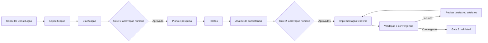

# Spec-Driven Development

O SDD trata a especificação como contrato vivo: a intenção aprovada governa plano, tarefas, implementação e validação. O código expressa essa intenção e não a substitui silenciosamente.

## Fluxo



A análise de consistência é um gate obrigatório entre tarefas e implementação, não uma fase extra. **Cada fase só avança com a aprovação do maintainer**: a conclusão de uma fase pelo agente não autoriza a seguinte.

## Fontes e responsabilidades

| Artefato                             | Responsabilidade                                        |
| ------------------------------------ | ------------------------------------------------------- |
| [`constitution.md`](constitution.md) | Princípios e restrições não negociáveis.                |
| [`specify.md`](specify.md)           | Criar e revisar `spec.md`.                              |
| [`clarify.md`](clarify.md)           | Resolver ambiguidades e registrar a primeira aprovação. |
| [`plan.md`](plan.md)                 | Pesquisar e definir a abordagem técnica.                |
| [`tasks.md`](tasks.md)               | Decompor o plano em incrementos test-first.             |
| [`implement.md`](implement.md)       | Executar tarefas e reconciliar descobertas.             |
| [`validate.md`](validate.md)         | Demonstrar conformidade e convergência.                 |

Em uma spec:

- `spec.md` é a única fonte vigente do comportamento e da intenção;
- `clarification.md` preserva o raciocínio, mas toda decisão comportamental é incorporada em `spec.md`;
- `research.md`, quando necessário, registra decisões, evidências, fontes e alternativas;
- `plan.md` define design e abordagem técnica;
- `tasks.md` registra a sequência executável e seu estado;
- `validation.md` registra comandos, resultados, limitações, cobertura e veredito.

Os templates estão em [`templates/`](templates/).

## Localização e identidade

```text
specs/YYYY-MM-DD-<domínio>-<capacidade>-<objetivo>/
```

- `YYYY-MM-DD`: data real de criação, válida no calendário, igual a `created_at` e imutável;
- `domínio`, `capacidade`, `objetivo`: segmentos em kebab-case, objetivos e pesquisáveis;
- o `id` canônico é o nome completo do diretório; o diretório independe do nome do branch;
- specs distintas no mesmo dia coexistem; uma identidade completa duplicada exige reconciliação.

Exemplo: `2026-10-20-vision-gesture-recognition-validate-waving-poc`.

## Estados

| Estado         | Condição mínima                                                          |
| -------------- | ------------------------------------------------------------------------ |
| `draft`        | Spec em elaboração.                                                      |
| `specified`    | Spec completa e checklist de especificação aprovado.                     |
| `clarified`    | Ambiguidades críticas resolvidas e Gate 1 registrado.                    |
| `planned`      | Pesquisa, plano, tarefas, análise de consistência e Gate 2 concluídos.   |
| `implementing` | Implementação autorizada e em andamento.                                 |
| `validating`   | Tarefas concluídas; evidências finais em coleta.                         |
| `validated`    | Requisitos, constituição e gates aplicáveis atendidos (Gate 3).          |
| `superseded`   | Outra spec a substitui; exige `related_specs` e seção `## Substituição`. |
| `abandoned`    | Trabalho interrompido; exige seção `## Abandono` com justificativa.      |

Mudanças de escopo retornam ao primeiro estado afetado. O Git preserva versões anteriores; não mantenha regras obsoletas no texto atual.

## Gates humanos

1. **Após Clarificação:** aprova comportamento, limites e critérios de sucesso.
2. **Após Plano e Tarefas:** aprova abordagem, riscos, sequência, testes e validação.
3. **Após Validação:** aceita a convergência com `aprovado` ou `aprovado com risco aceito`.

Cada aprovação registra status, pessoa ou função, data ISO, artefatos aprovados e referência verificável. Campos obrigatórios não podem conter `TODO`, `TBD` ou placeholders de template.

## Validação oficial

Use somente comandos de `package.json`. Quando existir um verificador estrutural de specs (`sdd:check`), ele passa a ser parte dos gates; até lá, a revisão é manual conforme as checklists. Ver [checks de qualidade](../../development-context/quality/quality-gates.md).
