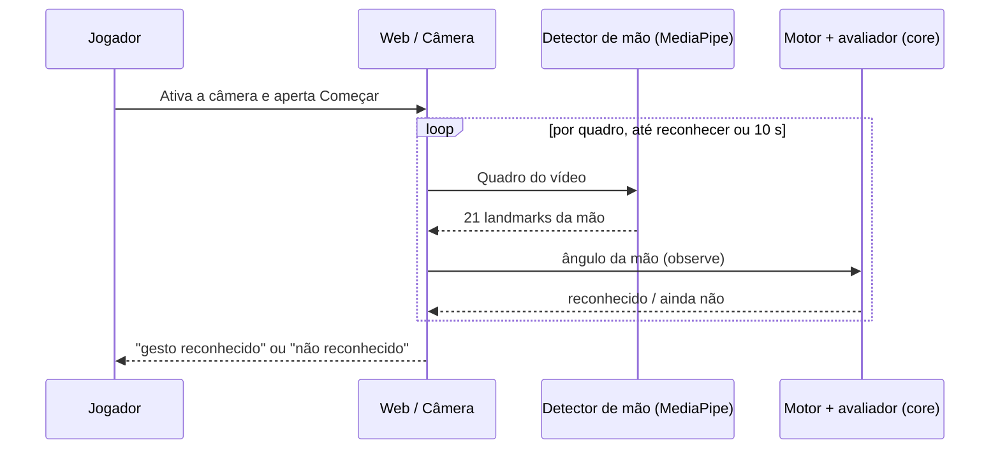

# Guess My Move — Especificação de produto e arquitetura

**Versão:** 0.2 · **Data:** 26/10/2026 · **Status:** em desenvolvimento (árbitro por visão computacional)  
**Repositório:** `guess-my-move` · **Natureza:** open-source · **Idioma deste documento:** português (Brasil)

> **Descrição para o GitHub**  
> An open-source charades game where the browser recognizes a card's gesture from the webcam using on-device computer vision — no server, no cloud AI.

> A fonte vigente do comportamento é a spec SDD [`specs/2026-10-26-vision-hand-gesture-referee-replace-llm-guesser/`](../../specs/2026-10-26-vision-hand-gesture-referee-replace-llm-guesser/spec.md). Em divergência, a spec aprovada prevalece sobre este documento.

## 1. Resumo executivo

**Guess My Move** é um jogo de mímica em que o jogador recebe uma carta com um gesto, ativa a webcam e executa o gesto. O **árbitro é a visão computacional local**: o navegador detecta a mão com o MediaPipe Hand Landmarker, calcula o ângulo da mão a cada quadro e um avaliador determinístico decide se o critério da carta foi cumprido. Nenhuma imagem sai do navegador e não há servidor nem provedor de IA no fluxo principal.

No primeiro experimento há **somente uma carta: “Acenar”**. O critério do Acenar é a oscilação repetida do ângulo da mão. A IA jogadora — uma IA que tenta adivinhar o gesto sem conhecer a carta — é uma **evolução futura** com spec própria; ela continuará sem receber a carta.

A hipótese técnica validada em spike é: _um detector de landmarks executado no navegador reconhece o Acenar de forma determinística, com poucos falsos positivos, sem enviar imagens a terceiros?_ O spike (12 clipes, uma pessoa) é evidência inicial, não acurácia geral.

**Escopo da entrega atual:** reconhecer o Acenar localmente, mostrar o que o detector lê para ajuste e remover do repositório o caminho por LLM. **Não é objetivo** treinar modelos, cobrir outros navegadores ou afirmar acurácia, taxa de quadros ou latência gerais.

## 2. Decisões e premissas

### 2.1 Decisões já tomadas (maintainer, 2026-10-26)

| Tema                         | Decisão                                                                                                                                                                                                                                                                                                                                                                                                                                                                                                                                                                                             |
| ---------------------------- | --------------------------------------------------------------------------------------------------------------------------------------------------------------------------------------------------------------------------------------------------------------------------------------------------------------------------------------------------------------------------------------------------------------------------------------------------------------------------------------------------------------------------------------------------------------------------------------------------- |
| Nome e repositório           | **Guess My Move** / `guess-my-move`.                                                                                                                                                                                                                                                                                                                                                                                                                                                                                                                                                                |
| Distribuição                 | Projeto público/open-source, vitrine de visão computacional no navegador.                                                                                                                                                                                                                                                                                                                                                                                                                                                                                                                           |
| Mecânica central             | Jogador faz o gesto; o app verifica por visão computacional local.                                                                                                                                                                                                                                                                                                                                                                                                                                                                                                                                  |
| Árbitro                      | Visão computacional determinística no navegador; sem LLM e sem servidor no fluxo principal.                                                                                                                                                                                                                                                                                                                                                                                                                                                                                                         |
| Primeira carta               | **Acenar**; começar com apenas uma para fechar o escopo.                                                                                                                                                                                                                                                                                                                                                                                                                                                                                                                                            |
| Início da rodada             | Botão **Começar**; a detecção automática do início fica para depois.                                                                                                                                                                                                                                                                                                                                                                                                                                                                                                                                |
| Feedback de depuração        | Mostrar o esqueleto da mão e os números do avaliador durante os testes.                                                                                                                                                                                                                                                                                                                                                                                                                                                                                                                             |
| Formato do critério da carta | Schema mínimo, só com o critério necessário ao Acenar; novas cartas ampliam o schema quando existirem.                                                                                                                                                                                                                                                                                                                                                                                                                                                                                              |
| Destino do código do LLM     | Removido. As specs substituídas e o histórico do Git são a referência para uma futura IA jogadora.                                                                                                                                                                                                                                                                                                                                                                                                                                                                                                  |
| Alvo de navegador            | Chrome desktop apenas.                                                                                                                                                                                                                                                                                                                                                                                                                                                                                                                                                                              |
| IA jogadora                  | Fora do escopo atual; spec futura, sem receber a carta.                                                                                                                                                                                                                                                                                                                                                                                                                                                                                                                                             |
| Segundo jogo (2026-10-27)    | Bolinhas de gude, bete solo: tiro com a mão pela câmera (pinça), alvo parado, tiros ilimitados.                                                                                                                                                                                                                                                                                                                                                                                                                                                                                                     |
| Modos de tiro do bete        | **Pinça** (padrão, mira relativa) e **Estalo (alpha)**, distinto na força e no gatilho: o polegar se estica de uma vez a partir da mão fechada; direção pela mesma mira relativa da pinça e força pela rapidez com que o polegar estica; depende de medição. O jogo das bolinhas usa o reconhecedor de gestos (`gesture_recognizer.task`) como veto de palma aberta e diagnóstico, com guia de etapas na tela.                                                                                                                                                                                      |
| Design system (2026-10-28)   | Issue #74, primeira entrega: um design system pequeno (tokens CSS e componentes base React em `apps/web/src/design/`) com a identidade escura com dourado do site de referência do maintainer, Space Grotesk nos títulos e DM Sans no corpo servidas pelo próprio app sem CDN, cantos retos e botão dourado. As variáveis antigas apontam para os tokens, então o menu e o jogo de cartas herdam paleta e fontes sem mudar de layout; a tela das bolinhas foi refeita com campo grande, câmera pequena e depuração recolhida. Menu, jogo de cartas, tema claro e logotipo ficam fora desta entrega. |

### 2.2 Decisões técnicas do agente (a partir do spike, revisáveis)

- **Detector e sinal:** Hand Landmarker (uma mão) e o ângulo do vetor pulso até o início do dedo médio; critério por inversões de direção com histerese em uma janela de tempo.
- **Limite de tempo da rodada:** 10 s como valor inicial, exposto como configuração do motor e ajustável conforme o teste.

### 2.3 Decisões em aberto

- Licença do arquivo `.task` do modelo, ainda não confirmada na fonte (por isso o arquivo não é versionado).
- Generalização para outras pessoas, câmeras e iluminação, a confirmar no teste manual do maintainer.
- Metas numéricas: ver §9; são as vigentes do projeto e ajustáveis conforme a medição.

## 3. Objetivos e não objetivos

### Objetivos

1. Reconhecer o Acenar localmente, em tempo de rodada, com critério determinístico, testável sem câmera e parametrizado pela carta.
2. Mostrar ao jogador, para depuração e ajuste, o que o detector lê: esqueleto da mão, ângulo, contagem de inversões, amostras, quadros e latência de inferência.
3. Preservar a privacidade: processamento 100% local, sem persistência, sem log de imagem e sem envio a terceiros.
4. Manter o repositório sem o código do fluxo por LLM, com os gates verdes.

### Não objetivos

- IA jogadora (adivinhar sem conhecer a carta); detecção automática do início do gesto.
- Mais de uma carta, baralho, pontuação, internacionalização, tempo de rodada configurável pela interface.
- Navegadores além do Chrome desktop; celular.
- Detecção de trapaça, multiplayer, autenticação, banco de dados, áudio.
- Treinar ou ajustar modelos; qualquer modelo além do Hand Landmarker pré-treinado.
- Afirmar acurácia, recall, falso positivo ou latência gerais a partir da amostra do spike.

## 4. Atores e fronteiras de informação

| Ator / componente      | Recebe                                           | Faz                                                                           | Não deve receber / fazer                                |
| ---------------------- | ------------------------------------------------ | ----------------------------------------------------------------------------- | ------------------------------------------------------- |
| **Jogador**            | Carta pública (palavra, dica, sugestão)          | Ativa a câmera, aperta Começar e faz o gesto                                  | Não recebe o critério de avaliação da carta.            |
| **Detector de mão**    | Quadros do vídeo                                 | Devolve os 21 pontos da mão por quadro                                        | Não sai do navegador; não persiste nem envia quadros.   |
| **Avaliador do gesto** | Amostras `(tempo, ângulo)` e o critério da carta | Decide reconhecido/não reconhecido por janela de tempo, puro e determinístico | Não acessa câmera, DOM nem MediaPipe.                   |
| **Motor da rodada**    | Carta, ângulo por quadro, relógio injetado       | Máquina de estados da rodada                                                  | Não guarda amostras fora da janela nem imagens.         |
| **Baralho** (dados)    | Definições de cartas                             | Oferece `public` e o critério privado de `evaluation`                         | Não expõe `evaluation` ao jogador (ver `toPublicCard`). |

**Nota.** A separação `public`/`evaluation` evita vazar o critério ao jogador e a uma IA jogadora futura. Ela não prova que o jogador executou o gesto; antifraude competitivo exigirá cuidados adicionais.

## 5. Carta inicial e contrato de dados

A carta separa `public` (o que o jogador vê) de `evaluation` (o critério do gesto, privado do motor). O schema é estrito em `packages/core/src/schemas/`: um campo inesperado invalida a carta, e `toPublicCard` devolve apenas `public`, com teste automatizado que falha se `evaluation` aparecer na projeção.

### 5.1 Carta “Acenar” (fonte: `packages/core/src/card/acenar.ts`)

**Visível ao jogador (`public`)**

- **Palavra:** Acenar.
- **Dica:** Um gesto usado para cumprimentar ou se despedir de alguém à distância.
- **Sugestão:** Levante uma das mãos e movimente-a de um lado para o outro.
- **Dificuldade:** `easy`.

**Privado para o motor (`evaluation`)**

- **Critério:** `hand-angle-oscillation` com `amplitudeDeg: 15`, `minReversals: 3`, `windowMs: 2500`, `minSamples: 5`. Valores iniciais confirmados no spike; ajustam-se na carta, sem mudar o código do avaliador.

### 5.2 Esquema da carta

```jsonc
{
    "id": "wave-001",
    "locale": "pt-BR",
    "public": {
        "word": "Acenar",
        "hint": "Um gesto usado para cumprimentar ou se despedir de alguém à distância.",
        "suggestion": "Levante uma das mãos e movimente-a de um lado para o outro.",
        "difficulty": "easy",
    },
    "evaluation": {
        "criterion": {
            "kind": "hand-angle-oscillation",
            "amplitudeDeg": 15,
            "minReversals": 3,
            "windowMs": 2500,
            "minSamples": 5,
        },
    },
}
```

O schema rejeita campos desconhecidos e valores não positivos. Adicionar uma carta é incluir outro objeto no baralho (`packages/core/src/card/deck.ts`); um novo tipo de critério exige ampliar o schema.

## 6. Experiência do usuário e fluxo da rodada

### 6.1 Fluxo

1. A interface apresenta a carta pública e o painel da câmera.
2. O jogador autoriza a câmera; o botão **Começar** fica habilitado quando a câmera está ativa e o detector carregado.
3. **Começar** inicia a rodada; o app lê um quadro por vez do vídeo, calcula o ângulo da mão e alimenta o avaliador.
4. O primeiro instante em que o avaliador reconhece o gesto encerra a rodada como **reconhecido**; o limite de 10 s encerra como **não reconhecido**.
5. Durante a rodada há **Cancelar**; ao fim há **Nova rodada**.
6. Falha do detector mostra mensagem em português, sem marcar reconhecimento nem consumir a rodada.

### 6.2 Estados da rodada (fonte: `packages/core/src/round/types.ts`)

Fluxo feliz:

`idle → card_revealed → camera_ready → detecting → (recognized | timed_out)`

Estados de exceção que encerram a rodada: `camera_denied`, `tracker_error`, `user_cancelled`. Uma nova rodada começa em `idle`.

### 6.3 Diagrama de sequência (conceitual)



## 7. Design técnico

### 7.1 Camadas

- **Núcleo (`packages/core`):** funções puras, sem DOM, câmera ou MediaPipe. Contém o schema da carta e `toPublicCard`, `handAngleDeg`, `evaluateOscillation` e a máquina de estados `createRound`.
- **Aplicação web (`apps/web`):** câmera com consentimento, detector atrás da interface `HandTracker`, laço por quadro, desenho do esqueleto e painel de depuração. Serve o `.wasm` e os modelos `.task` (`hand_landmarker.task` e `gesture_recognizer.task`) sem CDN.

### 7.2 Núcleo: ângulo, avaliador e rodada

- **`handAngleDeg(landmarks, aspect)`** (`gesture/angle.ts`): ângulo, em graus, do vetor do pulso (ponto 0) ao início do dedo médio (ponto 9); 0 aponta para cima, positivo para a direita da imagem. O deslocamento horizontal é corrigido pela proporção `aspect` (largura/altura). Devolve `null` quando faltam pontos, `aspect` é inválido ou o vetor é degenerado.
- **`evaluateOscillation(criterion, samples, nowMs)`** (`gesture/oscillation.ts`): considera as amostras da janela `(nowMs - windowMs, nowMs]`, conta inversões de direção com histerese de `amplitudeDeg` e devolve `{ recognized, reversals, windowSamples }`; reconhece quando `windowSamples >= minSamples` e `reversals >= minReversals`. Lacunas não são preenchidas: só contam as amostras com mão.
- **`createRound({ card, maxDurationMs, clock })`** (`round/round.ts`): máquina de estados com `revealCard`, `cameraReady`, `denyCamera`, `trackerFailed`, `start`, `observe(angleDeg)`, `tick`, `cancel`. O relógio é injetável; o limite padrão de `detecting` é 10 000 ms (`DEFAULT_MAX_DURATION_MS`). Guarda só as amostras da janela e descarta tudo ao terminar.

### 7.3 Aplicação web: detector, rodada e depuração

- **`HandTracker`** (`src/tracker/handTracker.ts`): `{ delegate, detect(video, timestampMs) → landmarks | null, close() }`. A implementação do MediaPipe (`mediapipeTracker.ts`) usa o `HandLandmarker` do `@mediapipe/tasks-vision` em modo de vídeo, com no máximo uma mão; tenta o delegate GPU e recua para CPU quando a criação falha. O parâmetro de URL `?delegate=cpu` ou `?delegate=gpu` força um delegate, sem recuo, para comparação; o delegate efetivo aparece no painel.
- **`GestureController` + `useGestureRound`** (`src/round/`): carregam o detector quando a câmera fica ativa, executam o laço por quadro durante `detecting`, medem a latência de cada inferência, atualizam o desenho e o painel e chamam `observe`.
- **`GestureScreen`, `HandOverlay`, `DebugPanel`** (`src/round/`): a tela desenha os 21 pontos e as conexões sobre o vídeo e mostra delegate, ângulo, inversões, amostras da janela, quadros, latência mediana e p95 de inferência.
- **Ativos (`apps/web/scripts/prepare-assets.mjs`):** copia o `.wasm` do pacote npm para `apps/web/public/mediapipe/wasm/` e baixa os modelos `.task` (`hand_landmarker.task` e `gesture_recognizer.task`) para `public/mediapipe/`, verificando o SHA-256 fixado de cada um; um arquivo existente com hash correto não é baixado de novo. Os modelos não são versionados; `public/mediapipe/` fica fora do Git. O jogo de cartas usa o `hand_landmarker.task`; o jogo das bolinhas usa o `gesture_recognizer.task` (landmarks mais o gesto pronto da mão). O script roda em `yarn dev:web` e `yarn build`.

### 7.4 Contratos e dados

- `Card.evaluation = { criterion: { kind: 'hand-angle-oscillation', amplitudeDeg, minReversals, windowMs, minSamples } }`, estrito.
- `HandSample = { t: number; angleDeg: number }`, com `t` em ms do relógio injetado.
- A API pública do núcleo é reduzida de forma deliberada; não há consumidores externos.

## 8. Entregas

| Fase                           | Objetivo                                                          | Critério para avançar                                                                                                                                                                                                                |
| ------------------------------ | ----------------------------------------------------------------- | ------------------------------------------------------------------------------------------------------------------------------------------------------------------------------------------------------------------------------------ |
| **Núcleo determinístico**      | Ângulo, avaliador, rodada e carta como funções puras testadas.    | Testes verdes, incluindo as fixtures dos 12 clipes de referência.                                                                                                                                                                    |
| **Aplicação web**              | Câmera, detector, laço por quadro, desenho e depuração.           | Rodada completa no Chrome desktop do maintainer; latência registrada.                                                                                                                                                                |
| **Remoção do caminho por LLM** | Sem `apps/server`, `packages/providers`, `packages/benchmark`.    | `yarn check:all` verde, sem código órfão.                                                                                                                                                                                            |
| **IA jogadora (futura)**       | IA adivinha sem conhecer a carta.                                 | Spec própria; fora do escopo atual.                                                                                                                                                                                                  |
| **Bete solo (segundo jogo)**   | Tiro com a pinça da mão contra um alvo parado, em `marbles.html`. | Specs `2026-10-27-game-marbles-bete-build-pinch-shot`, `2026-10-27-game-marbles-bete-build-flick-beta` e `2026-10-27-game-marbles-bete-refine-flick-thumb-release`; teste manual do maintainer; decisão sobre o estalo na issue #68. |

## 9. Critérios de aceite e metas

### 9.1 Critérios de aceite (BDD)

**A — reconhecimento positivo:** câmera ativa e jogador acenando após **Começar** ⇒ o app indica "gesto reconhecido" e encerra a rodada.  
**B — limite sem gesto:** a rodada começou e o limite termina sem o critério ⇒ "não reconhecido".  
**C — confusores:** coçar a cabeça, ajeitar o fone ou manter a mão parada levantada ⇒ "não reconhecido" ao fim do limite.  
**D — critério testável sem câmera:** o avaliador sobre as séries de ângulo dos 12 clipes de referência ⇒ 5 acenos reconhecidos e 0 confusores.  
**E — câmera negada:** câmera negada ⇒ o app explica como reabilitar a permissão e nenhum detector é executado.  
**F — sem rede nem terceiros:** inspeção das requisições de uma rodada ⇒ nenhuma carrega imagem, vídeo ou landmarks e nenhuma vai a domínio de terceiros.

### 9.2 Metas vigentes (ajustáveis)

- Recall >= 80%; falsos positivos <= 10%, com nenhum em "pessoa parada".
- Mediana do tempo entre apertar Começar e o reconhecimento <= 8 s; p95 <= 15 s.

As metas são referência do projeto e ajustáveis conforme o resultado do teste do maintainer. A latência por quadro e o delegate efetivo são registrados em `validation.md` com número, máquina e navegador.

### 9.3 Evidência honesta

O spike (12 clipes, uma pessoa, em Chromium headless) é evidência inicial, não acurácia geral. Resultados nos clipes variam com a taxa de amostragem (15/s: 5 de 5 acenos e 0 de 7 confusores; 7,5/s: 7 de 10 acenos; 5/s: 9 de 15). A latência medida no spike foi só numa VPS (CPU, 100 a 210 ms por quadro) e não representa o desktop do maintainer. Nenhum texto afirma acurácia, taxa de quadros ou latência gerais.

## 10. Segurança e privacidade

- **Processamento local:** nenhuma imagem, vídeo ou landmark é enviado, gravado ou registrado em log. Uma rodada não gera requisição de rede com mídia; só há o carregamento do app e dos arquivos do detector, servidos pelo próprio app.
- **Sem servidor nem segredo:** não há `apps/server`, variáveis de ambiente de provedor nem chave de IA no fluxo principal.
- **Câmera:** consentimento explícito do navegador, indicador de câmera ativa e opção de parar a captura. Em conteúdo de menores, aplicar salvaguardas antes de ampliar o público.
- **Modelos:** os arquivos `.task` (`hand_landmarker.task` e `gesture_recognizer.task`) não são versionados; suas licenças não foram confirmadas na fonte e a verificação fica pendente antes de qualquer redistribuição (registro em `research.md`).

## 11. Riscos e mitigação

| Risco                                                | Mitigação                                                | Contingência                                   |
| ---------------------------------------------------- | -------------------------------------------------------- | ---------------------------------------------- |
| Falso positivo ou negativo em outra pessoa ou câmera | Painel de depuração com números; limiares na carta       | Ajustar o critério da carta sem mudar o código |
| GPU indisponível ou lenta                            | Recuo automático para CPU; delegate exibido; `?delegate` | Fixar CPU                                      |
| Download do modelo falha ou muda                     | Hash SHA-256 fixado; mensagem clara; arquivo em cache    | Fixar outra versão do modelo com novo hash     |
| Aceno lento não acumula inversões a tempo            | Limite de 10 s ajustável                                 | Ajustar `maxDurationMs` ou o critério          |
| Licença do modelo incompatível com redistribuição    | Modelo não versionado                                    | Trocar de modelo ou treinar um próprio         |

## 12. Backlog

**Atual**

- [x] Núcleo: ângulo, avaliador, rodada e carta com testes.
- [x] Aplicação web: câmera, detector, laço por quadro, desenho e painel de depuração.
- [x] Remoção de `apps/server`, `packages/providers` e `packages/benchmark`.
- [ ] Teste manual do maintainer no Chrome desktop e registro em `validation.md`.

**Futuro (orientado por resultados)**

- [ ] Detecção automática do início do gesto.
- [ ] Novas cartas e novos tipos de critério, ampliando o schema.
- [ ] Modo de IA jogadora (sem receber a carta), com spec própria.
- [ ] Pontuação, tempo e, se útil, internacionalização.

## 13. Definição de pronto

A entrega atual está pronta quando a rodada completa roda no Chrome desktop do maintainer com reconhecimento do Acenar e rejeição dos confusores; o avaliador reconhece 5 de 5 acenos e 0 de 7 confusores nas fixtures; nenhuma requisição de rede carrega mídia; o repositório não contém `apps/server`, `packages/providers` nem `packages/benchmark`; e `yarn check:all`, `yarn sdd:check`, `yarn docs:format:check` e `yarn test:gates` passam.

## 14. Próximo passo

Executar o teste manual do maintainer no Chrome desktop, registrar latência e delegate em `validation.md` e ajustar os limiares da carta se necessário. A IA jogadora só começa depois, com spec própria.
