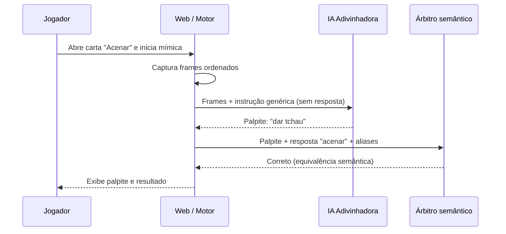

# Guess My Move — Especificação de produto e arquitetura

**Versão:** 0.1 · **Data:** 20/10/2026 · **Status:** planejamento / prova de conceito  
**Repositório:** `guess-my-move` · **Natureza:** open-source · **Idioma deste documento:** português (Brasil)

> **Descrição para o GitHub**  
> An open-source AI-powered charades game where players act out prompts on camera and AI tries to guess what they're miming.

## 1. Resumo executivo

**Guess My Move** é um jogo de mímica em que uma pessoa recebe uma carta com uma palavra, interpreta essa palavra diante da webcam e desafia uma IA a adivinhar a representação. O diferencial é inverter a lógica convencional: **o humano faz a mímica e a IA tenta descobrir o que ela significa**.

No primeiro experimento, haverá **somente uma carta: “Acenar”**. A IA adivinhadora recebe imagens do movimento, mas **não recebe a palavra da carta, a dica, a sugestão nem os critérios internos**. Um **árbitro semântico** verifica automaticamente se o palpite tem o mesmo significado da resposta esperada. **Não haverá confirmação manual de acerto como fonte de verdade**.

A hipótese técnica a validar é: *um modelo multimodal pré-treinado consegue identificar ações simples a partir de uma sequência curta de imagens com precisão e latência adequadas para uma experiência divertida?*

**Escopo da primeira entrega:** testar a interpretação visual e produzir uma demonstração de ponta a ponta. **Não é objetivo inicial** criar um classificador treinado do zero, construir um sistema antifraude completo ou interpretar qualquer mímica de forma confiável.

## 2. Decisões e premissas

### 2.1 Decisões já tomadas na conversa

| Tema | Decisão |
|---|---|
| Nome e repositório | **Guess My Move** / `guess-my-move`. |
| Distribuição | Projeto público/open-source, pensado como vitrine de visão computacional e integração com IA. |
| Mecânica central | Pessoa faz a mímica; IA adivinha. Modalidade inversa é evolução futura. |
| Interface de carta | Palavra + dica (*hint*) + sugestão de como representar. |
| Primeira carta | **Acenar**; começar com apenas uma para fechar o escopo. |
| Conhecimento da IA adivinhadora | A IA **não conhece** a resposta da carta antes de palpitar. |
| Verificação de acerto | Automática, por **árbitro semântico**; usuário não decide se o palpite acertou. |
| Estratégia de IA inicial | Usar um **modelo multimodal pré-treinado**, sem treinamento/fine-tuning próprios. |
| Estratégia visual inicial | Enviar **sequências curtas de frames**; não depender do MediaPipe na PoC. |
| Critério visual de execução | Previsto para evolução; **não será árbitro visual na primeira versão**. |
| Extensibilidade | Carta com metadados privados de avaliação e componentes desacoplados. |

### 2.2 Recomendações técnicas (ainda não são decisões fechadas)

- **Frontend:** React + Vite + TypeScript, por familiaridade e rapidez de execução.
- **Servidor:** um pequeno backend Node.js/TypeScript ou função serverless para proteger a chave da API. NestJS pode entrar quando houver necessidade real de mais estrutura.
- **Interpretação visual:** interface de provedor multimodal, para testar e substituir modelos sem reescrever o jogo.
- **Adivinhação:** um palpite por tentativa, a partir de uma janela curta de frames com indicação de ordem/tempo.
- **Julgamento:** comparação normalizada/exata e aliases cadastrados antes de recorrer a um LLM para casos ambíguos.
- **Dados:** carta em JSON/TypeScript versionado no Git; banco de dados não é necessário no início.
- **Persistência:** evitar armazenamento permanente de vídeos ou imagens no MVP.

### 2.3 Decisões em aberto

O projeto ainda precisa escolher provedor/modelo multimodal, idioma padrão da interface, licença open-source, hospedagem, limites de tentativas/tempo, metas de latência/custo e forma de coletar métricas de avaliação com consentimento. **Não tratar esses pontos como aprovados ou definidos.**

## 3. Objetivos e não objetivos

### Objetivos da prova de conceito (PoC)

1. Solicitar permissão de câmera no navegador e capturar frames em sequência.
2. Enviar o conjunto de imagens, em ordem temporal, a um modelo multimodal por uma integração segura.
3. Exibir um palpite textual sobre a ação observada.
4. Executar o cenário da carta **Acenar** e comparar contra cenários negativos.
5. Medir acertos, respostas equivocadas, tempo de resposta e, quando disponível, custo por tentativa.

### Objetivos do MVP jogável

1. Exibir a carta com palavra, dica e sugestão.
2. Iniciar e encerrar uma rodada.
3. Enviar frames ao adivinhador **sem revelar a carta**.
4. Receber palpites, submetê-los ao árbitro semântico e apresentar acerto/erro.
5. Possibilitar novas tentativas após erros, sem repetir palpites rejeitados.
6. Tratar câmera negada, timeout do modelo, resposta inválida e falha de rede.

### Fora do escopo inicial

Treinar modelos; classificar qualquer ação arbitrária; verificar por visão computacional se o jogador executou corretamente o movimento; ranking competitivo; detecção robusta de trapaça; multiplayer; autenticação; banco de dados; streaming contínuo; áudio e reconhecimento de fala; geração de animações por IA.

## 4. Atores, responsabilidades e fronteiras de informação

| Ator / componente | Recebe | Faz | Não deve receber / fazer |
|---|---|---|---|
| **Jogador** | Carta com palavra, dica e sugestão | Interpreta a ação diante da webcam | Não determina oficialmente se o palpite acertou. |
| **IA adivinhadora** | Frames, ordem temporal, contexto genérico da mecânica e, depois, palpites rejeitados | Produz hipótese textual sobre a mímica | **Não recebe** palavra, dica, sinônimos, critérios privados nem resposta esperada. |
| **Árbitro semântico** | Resposta da carta, aliases e palpite da IA | Decide se o palpite é semanticamente equivalente | Não precisa analisar webcam e não comprova que a mímica foi executada. |
| **Motor do jogo** | Estado da rodada, carta, frames e retornos dos componentes | Orquestra a partida, tentativas e resultados | Não confunde um palpite semanticamente correto com prova visual de execução. |
| **Baralho** (dados) | Definições de cartas | Oferece informações públicas e metadados privados de avaliação | Não é um agente/ator de IA. |

**Nota de segurança do escopo:** a resposta aparecerá na interface do jogador. Separar informações no fluxo de chamadas impede o *vazamento acidental ao adivinhador*, mas **não prova que o próprio jogador seja honesto**. Antifraude competitivo exigirá cuidados adicionais, inclusive validação visual e proteção da integridade da partida.

## 5. Carta inicial e contrato de dados

### 5.1 Carta “Acenar”

**Visível ao jogador**

- **Palavra:** Acenar.
- **Dica:** Um gesto usado para cumprimentar ou se despedir de alguém à distância.
- **Sugestão:** Levante uma das mãos e movimente-a de um lado para o outro.
- **Dificuldade:** Fácil (rótulo proposto; não essencial à PoC).

**Privado para o árbitro e o motor de jogo**

- **Resposta canônica:** `acenar`.
- **Expressões aceitas (exemplos):** `dar tchau`, `acenando`, `waving`, `waving goodbye`.
- **Respostas insuficientes (exemplos):** `levantar a mão`, `mexer os braços`, `cumprimentar alguém` sem descrição mais específica.
- **Critérios visuais futuros:** uma mão erguida com movimento lateral repetido, compatível com cumprimento/despedida. **Não utilizados no MVP sem árbitro visual.**

Os aliases representam política de julgamento — **não devem ser fornecidos ao adivinhador**. Um sinônimo só deve contar quando preservar a ação-alvo, não apenas o tema geral.

### 5.2 Exemplo de esquema lógico (ilustrativo)

```json
{
  "id": "wave-001",
  "locale": "pt-BR",
  "public": {
    "word": "Acenar",
    "hint": "Um gesto usado para cumprimentar ou se despedir de alguém à distância.",
    "suggestion": "Levante uma das mãos e movimente-a de um lado para o outro.",
    "difficulty": "easy"
  },
  "evaluation": {
    "canonicalAnswer": "acenar",
    "acceptedAliases": ["dar tchau", "acenando", "waving", "waving goodbye"],
    "insufficientGuesses": ["levantar a mão", "mexer os braços"],
    "visualCriteria": [
      "Uma das mãos aparece levantada.",
      "Há deslocamento lateral repetido da mão ao longo do tempo."
    ]
  }
}
```

Em uma versão com pontuação competitiva, os metadados de avaliação precisam ser autoridade do servidor. Para a PoC, a separação do payload enviado ao modelo já é suficiente para validar a ideia — sem reivindicar segurança antifraude.

## 6. Experiência do usuário e fluxo da rodada

### 6.1 Fluxo jogável previsto

1. A interface apresenta a carta **Acenar** ao jogador.
2. O usuário autoriza a câmera e clica em **Iniciar mímica**.
3. O navegador captura uma sequência curta de frames com ordem temporal identificada.
4. O motor envia somente esses frames e instruções genéricas à IA adivinhadora.
5. A IA retorna **um palpite**, por exemplo: “Você está dando tchau”.
6. O árbitro compara “dar tchau” com a resposta `acenar` e marca **correto**, sem intervenção manual.
7. Se o palpite fosse “Você está levantando a mão”, o árbitro indicaria **incorreto**, e o motor permitiria nova tentativa.
8. A rodada termina por acerto, limite de tentativas, tempo esgotado ou encerramento manual.

**Comportamento importante:** não prometer reconhecimento contínuo em tempo real. O primeiro protótipo trabalha por **janelas de captura** e respostas assíncronas. A experiência precisa mostrar quando está capturando, processando e apresentando o palpite.

### 6.2 Estados sugeridos

`idle → card_revealed → camera_ready → capturing → guessing → judging → (correct | retry | finished)`

Estados de exceção: `camera_denied`, `request_timeout`, `provider_error`, `invalid_model_response`, `user_cancelled`.

### 6.3 Diagrama de sequência (conceitual)



## 7. Design técnico: proposta inicial

### 7.1 Camadas

**Aplicação web:** carta, permissão e preview da câmera, captura temporária de frames, interface de tentativas e resultado. 

**Motor da partida:** máquina de estados, seleção da carta, limites, histórico de palpites e integração com adivinhador/árbitro.

**Adaptador de modelo visual:** monta a requisição ao provedor escolhido; recebe frames com ordenação temporal; valida uma saída estruturada que contenha um único palpite. Não injeta pistas privadas.

**Árbitro semântico:** normaliza pontuação/maiúsculas/acentuação e verifica resposta canônica/aliases. Se necessário, aplica uma política de equivalência via LLM com resposta estruturada. Não julga a veracidade do gesto pelo vídeo.

**Servidor mínimo:** guarda segredos, aplica limites de payload, autenticação operacional da API se necessário e limites de taxa/custo; pode ser uma função serverless ou um pequeno serviço Node/TypeScript. **Nunca colocar chave de provedor de IA no bundle do navegador**.

### 7.2 Contratos internos sugeridos

```ts
type GuessInput = {
  frames: Array<{ data: string; timestampMs: number; mimeType: string }>;
  rejectedGuesses: string[];
  language?: string;
};

type GuessResult = { guess: string };

type SemanticJudgeInput = {
  canonicalAnswer: string;
  acceptedAliases: string[];
  insufficientGuesses: string[];
  guess: string;
};

type SemanticJudgeResult = {
  isCorrect: boolean;
  method: 'canonical' | 'alias' | 'llm' | 'undetermined';
  matchedAnswer?: string;
};
```

**Cuidados:** `confidence` autodeclarada por LLM não é uma probabilidade calibrada. Não usá-la diretamente como garantia de reconhecimento. Frames devem ter limites de resolução, número, tamanho total e duração. Essas interfaces são exemplos para guiar a implementação, não uma exigência rígida de nomes.

### 7.3 Captura e prompts

- Capturar alguns frames **ao longo de um intervalo**, em vez de enviar só uma foto.
- Preservar explicitamente a ordem dos frames; o modelo pode falhar em reconhecer ações temporais mesmo assim.
- Reduzir resolução e quantidade de imagens para controlar latência, rede e custo.
- Instruir o adivinhador a descrever a **ação predominante** e produzir **uma única hipótese curta**, em resposta estruturada.
- Proibir no prompt da adivinhação referências à carta secreta. Não incluir dica, sugestão ou aliases em histórico, logs enviados ao modelo ou mensagens auxiliares.
- Rejeitar respostas vazias, fora de formato ou que aleguem certeza sem evidência; oferecer erro controlado ou nova tentativa.
- Para testes, implementar um `MockGuesser` configurável, sem consumo de API.

### 7.4 Política do árbitro semântico

1. Normalizar texto sem desfigurar significado: minúsculas, espaços, pontuação e variantes triviais.
2. Comparar com resposta canônica e aliases **por equivalência de expressão**, não pela presença de uma palavra como substring.
3. Se o palpite for explicitamente genérico/insuficiente, marcar incorreto.
4. Se permanecer ambíguo, opcionalmente consultar LLM com *canonical answer*, aliases, exemplos aceitos/rejeitados e critérios conservadores.
5. Se o LLM falhar ou houver dúvida material, retornar `undetermined` e adotar uma regra de UX explícita (por exemplo, pedir nova tentativa); não inventar decisão.
6. Registrar método e motivo resumido, quando possível, para auditoria e ajuste de aliases.

**Limite assumido:** com apenas o árbitro semântico, um palpite correto por acaso pode ganhar a rodada mesmo que o movimento não tenha ocorrido. Esse risco permanece até a inclusão de um árbitro visual.

## 8. Entregas incrementais

| Fase | Objetivo | Entregáveis | Critério para avançar |
|---|---|---|---|
| **Fase 0 — PoC visual** | Validar reconhecimento de “acenar”. | Webcam, frames temporais, integração protegida, palpite, testes manuais, medições iniciais. | Evidência de que o provedor reconhece o gesto com desempenho promissor em condições variadas. |
| **Fase 1 — MVP jogável** | Fechar um ciclo de rodada sem confirmação humana. | Carta, motor, árbitro semântico, tentativas, estados de erro, documentação e testes. | Rodada reproduzível com acerto, erro e falha de provedor tratados. |
| **Fase 2 — Expansão de conteúdo** | Escalar baralho e jogo. | Mais cartas, categorias, níveis, cronômetro/pontos, configurações de idioma, telemetria opt-in. | Cartas novas não exigem alterar algoritmos centrais. |
| **Fase 3 — Arbitragem visual** | Verificar se a mímica foi efetivamente executada. | Critérios visuais por carta, verificação multimodal independente, calibração e contestação. | Menor incidência de acertos por coincidência e falsos positivos mensurados. |
| **Fase 4 — Modos avançados** | Enriquecer o produto. | IA faz mímica, modo multiplayer, rankings, modelos locais, pose estimation/classificadores temporais conforme evidências. | Justificativa técnica e de custo a partir de resultados reais. |

Estimativas iniciais discutidas (não compromissos): **4–8 horas** para uma PoC visual mínima; **2–5 dias** para um MVP jogável; **1–3 semanas** para amadurecer robustez, dependendo da qualidade do reconhecimento.

## 9. Critérios de aceite e casos de teste

### 9.1 Critérios de aceite em BDD

**Cenário A — reconhecimento positivo**  
**Dado** que a câmera foi autorizada e o jogador está acenando,  
**Quando** a aplicação envia frames ordenados ao adivinhador,  
**Então** recebe um palpite legível e o exibe ao jogador, ou sinaliza claramente a impossibilidade de obter um palpite.

**Cenário B — sinônimo aceito**  
**Dado** que a carta esperada é `acenar`,  
**Quando** o palpite for `dar tchau`,  
**Então** o árbitro semântico marca o palpite como correto e registra que o acerto decorreu de alias.

**Cenário C — palpite excessivamente genérico**  
**Dado** que a carta esperada é `acenar`,  
**Quando** o palpite for `levantar a mão`,  
**Então** o árbitro semântico marca o palpite como incorreto.

**Cenário D — não revelar a resposta**  
**Dado** que a carta foi revelada apenas ao jogador,  
**Quando** o motor invocar a IA adivinhadora,  
**Então** o payload enviado ao modelo não contém palavra, dica, sugestão, aliases ou critérios de avaliação da carta.

**Cenário E — permissão negada**  
**Dado** que o navegador negou acesso à câmera,  
**Quando** a rodada for iniciada,  
**Então** o sistema não faz invocação ao modelo e informa como reabilitar a permissão.

**Cenário F — erro de provedor**  
**Dado** que o provedor está indisponível ou a resposta é inválida,  
**Quando** uma tentativa falhar,  
**Então** o sistema mostra erro recuperável, mantém a integridade do estado e não marca acerto.

### 9.2 Matriz inicial de avaliação

Executar cenários positivos e negativos, sempre registrando o resultado esperado por um observador humano:

- **Positivos:** aceno frontal, de perfil parcial, com mão direita/esquerda, ritmos distintos e fundos diferentes.
- **Negativos:** pessoa parada, mão erguida sem movimento, movimentos de braços sem aceno e ausência de pessoa.
- **Limites:** iluminação ruim, enquadramento parcial da mão, oclusões, instabilidade da rede.
- **Semântica:** `acenar`, `dar tchau` e `waving` devem ser aceitos; `levantar a mão` deve ser recusado.

Registrar, no mínimo, **acertos por cenário**, **falsos positivos**, **tempo por tentativa** (mediana e p95 se houver amostra), **custo estimado por tentativa** e **falhas técnicas**. Não anunciar uma taxa de precisão geral a partir de poucas rodadas nem confundir avaliação do árbitro semântico com acurácia visual.

Metas numéricas de lançamento permanecem **em aberto** até um teste piloto com amostra suficiente.

## 10. Segurança, privacidade, custos e observabilidade

**Privacidade e câmera:** solicitar consentimento explícito do navegador, mostrar indicador de câmera ativa, permitir parar a captura, não salvar imagens/vídeos por padrão, evitar registrar dados de imagem em logs e descrever quando frames são enviados a um provedor externo. Em conteúdo de menores, aplicar salvaguardas apropriadas antes de expandir o público.

**Chaves e infraestrutura:** armazenar credenciais apenas no servidor; configurar variáveis de ambiente; adicionar `.env.example` sem segredos; evitar commits com material sensível; impor rate limit e limites de payload. Acesso às rotas de API não deve permitir consumo irrestrito da chave de IA.

**Custos:** custos crescem com imagens por tentativa, resolução, frequência de tentativas e modelo usado. Iniciar com poucos frames, limitar tentativas concorrentes e registrar uso/tokens quando o provedor expuser esses dados. Evitar depender de um preço/modelo específico antes de um benchmark.

**Observabilidade:** eventos sem mídia bruta, como `round_started`, `frames_captured`, `guess_received`, `guess_judged`, `round_finished`, `provider_failed`, com `round_id` e tempos. O histórico de palpites pode ficar apenas na memória no MVP; persistência é uma decisão posterior.

**Qualidade e comunidade:** separar mocks de chamadas pagas; testes unitários do árbitro e do motor; instruções claras para executar localmente; explicitar limitações técnicas no README; definir licença antes de divulgar o projeto como reutilizável por terceiros.

## 11. Riscos e mitigação

| Risco | Consequência | Mitigação inicial |
|---|---|---|
| Modelo não entende movimento em frames esparsos | Palpites errados, experiência ruim | Aumentar/ajustar janelas de frames; comparar modelos; considerar vídeo nativo quando disponível. |
| Latência alta | Rodadas lentas | Captura sob demanda, imagens reduzidas, feedback visual, limites de timeout. |
| Adivinhador recebe resposta da carta | Acertos artificiais, PoC inválida | Testar payloads; interfaces públicas/privadas separadas; revisar logs e prompts. |
| Árbitro aceita resposta vaga | Falsos acertos | Aliases específicos, exemplos negativos, testes semânticos automatizados. |
| Jogador não representa a carta | Acertos por sorte ou exploração | Aceitar como limite do MVP; avaliar árbitro visual em fase posterior. |
| Exposição de dados da webcam | Falha de confiança e privacidade | Captura transitória, consentimento, ausência de persistência padrão, documentação. |
| Consumo excessivo de API | Custo imprevisível | Quotas, resolução limitada, rate limiting, métricas por tentativa. |
| Dependência de um provedor | Lock-in | Interface `GuesserProvider`, mocks e configuração externa. |

## 12. Backlog inicial priorizado

**P0 — Comprovar viabilidade visual**

- [ ] Iniciar projeto React/Vite/TypeScript com documentação básica.
- [ ] Implementar câmera com consentimento, visualização e parada explícita.
- [ ] Capturar frames ordenados e temporários com limites configuráveis.
- [ ] Criar endpoint/proxy seguro para modelo multimodal e um provedor mockado.
- [ ] Exibir palpite ou erro técnico de forma distinguível.
- [ ] Rodar e documentar matriz de testes da carta “Acenar”.

**P1 — Tornar jogável**

- [ ] Implementar carta pública e metadados privados de avaliação.
- [ ] Criar máquina de estados da rodada e limites configuráveis de tentativas.
- [ ] Implementar árbitro semântico determinístico com testes.
- [ ] Prever interface opcional para fallback LLM, sem torná-lo obrigatório na primeira execução.
- [ ] Bloquear vazamento da carta para o adivinhador, com teste automatizado.
- [ ] Incluir histórico de palpites rejeitados, tratamento de erros e instruções de execução.

**P2 — Evolução orientada por resultados**

- [ ] Benchmark entre modelos/provedores e parâmetros de captura.
- [ ] Criar baralho com múltiplas cartas/categorias.
- [ ] Acrescentar pontuação, tempo e, se útil, internacionalização.
- [ ] Prototipar árbitro visual e comparar ganhos reais.
- [ ] Avaliar MediaPipe, modelos temporais e inferência local **somente se os resultados justificarem**.

## 13. Definição de pronto das primeiras entregas

A **PoC** está pronta quando a webcam funciona em ambiente local seguro (localhost/HTTPS), o servidor mantém a chave da API protegida, o modelo gera um palpite a partir de uma sequência de frames, falhas são compreensíveis e existe um relatório de testes positivos e negativos com limitações explícitas.

O **MVP** está pronto quando o ciclo carta → mímica → frames → palpite → árbitro → resultado funciona sem confirmação manual; respostas equivalentes são reconhecidas de modo previsível; casos genéricos não são aceitos; não existe vazamento acidental da resposta ao modelo; e o projeto contém testes, instruções de execução, `.env.example` e explicação de privacidade.

## 14. Próximo passo recomendado

**Executar primeiro a Fase 0, sem antecipar o restante.** Iniciar a aplicação, validar captura de frames e capacidade do modelo de reconhecer “Acenar”. Só depois implementar o árbitro e o motor da partida. Isso preserva o orçamento de tempo e evita construir abstrações sobre uma hipótese visual ainda não comprovada.

O arquivo **`DEVELOPMENT_PROMPT.md`** acompanha esta especificação e pode ser fornecido a um agente de programação. Ele define a ordem das entregas, as restrições arquiteturais e os critérios para não expandir indevidamente o escopo.

---

*Documento elaborado a partir das decisões discutidas para Guess My Move. Propostas técnicas, estimativas e escolhas em aberto foram identificadas separadamente para evitar que recomendações sejam confundidas com decisões já tomadas.*
