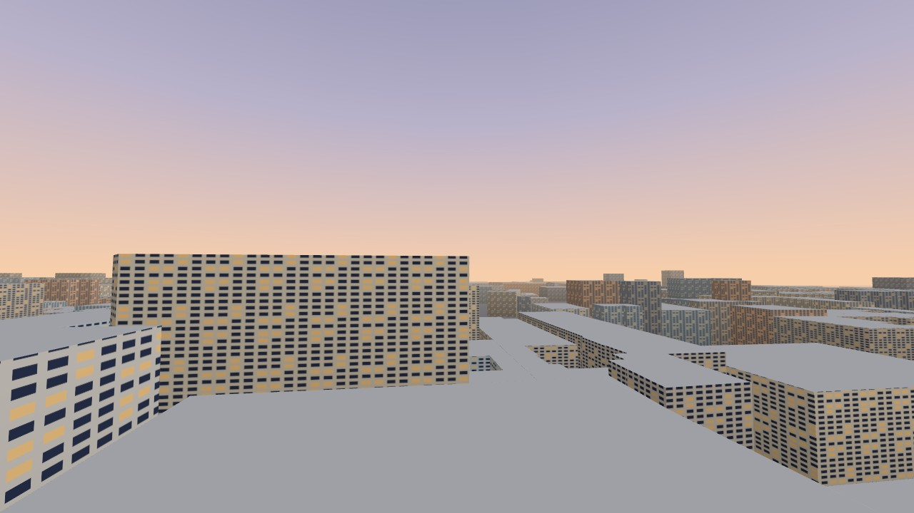
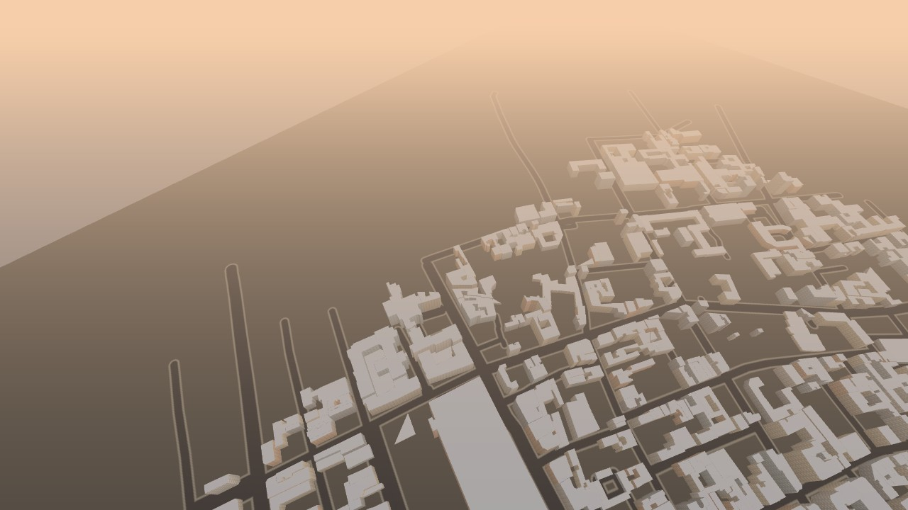
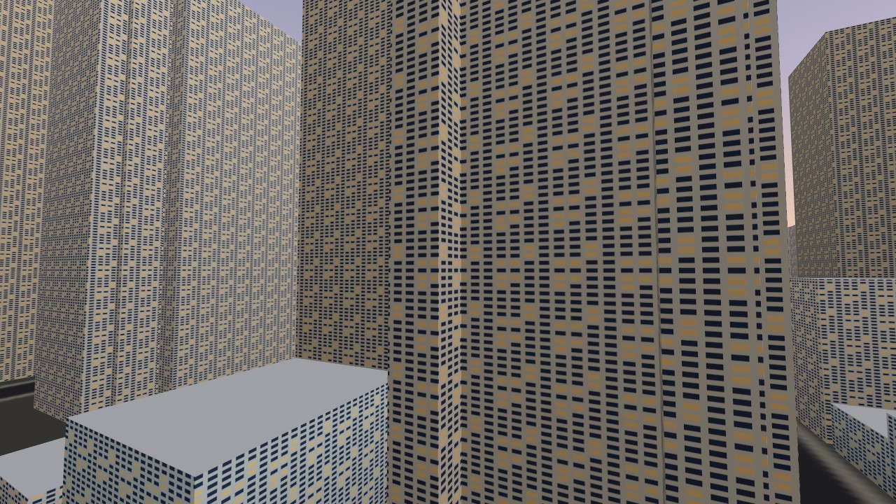
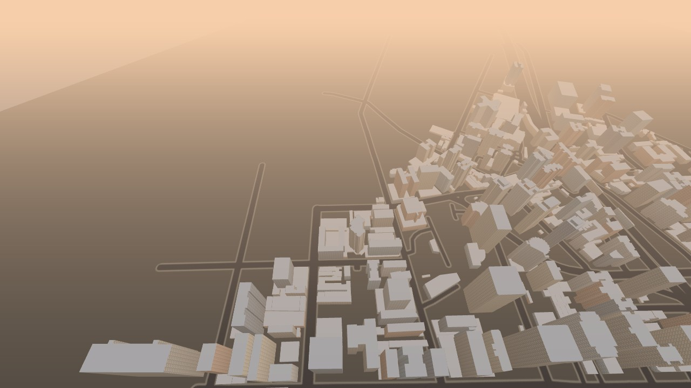

# Mapas e projetos abertos para levar cidades reais ao Arranha-Teia

> **Escopo.** Investigação técnica (sem implementação) para a issue [#82](https://github.com/wezercarvalho/guess-my-move/issues/82). Levanta as opções de **dados de prédios** e de **renderização** para evoluir o cenário do Arranha-Teia de um único trecho de Midtown para cidades reais adicionadas aos poucos. Nenhuma mudança em `packages/` ou `apps/`: o relatório é a entrega. A spec vigente do jogo é `specs/2026-10-28-game-arranha-teia-build-first-person-web-swing/`; este documento é o contexto de evolução, não a reescreve.

> **Aviso de evidência.** O documento separa o que está **[DOCUMENTADO]** (página oficial, com URL e data de consulta), o que é **[MEDIDO]** (número obtido nesta máquina, com as condições do teste), o que é **[ESTIMADO]** (cálculo nosso a partir de dado documentado, com premissa explícita) e o que está **[NÃO VERIFICADO]** (não li a fonte neste ciclo ou depende de teste futuro). **Nenhuma afirmação de realismo, desempenho ou fps aparece sem medição registrada como texto.** As imagens são renders do nosso próprio motor (ver seção 6); não há captura de demo de terceiros (ver seção 5.4 para o motivo).

> **Regra não negociável do projeto.** Todas as requisições do app em tempo de jogo vão para a **própria origem**; nada de CDN nem serviço de terceiros durante a partida, e nenhuma chave de API no navegador (ver [privacidade e segredos](../development-context/security/privacy-and-secrets.md)). Este é o filtro que separa "dá para usar" de "não dá" na tabela da seção 2. A colisão e a mira da teia dependem de um **índice espacial de prédios** (`packages/swing/src/cityIndex.ts`): o realismo visual só serve se a geometria também colidir.

**Tipo:** investigação · **Consultado em:** 2026-10-29 · **Estado:** proposta para o maintainer decidir com base nas imagens.

## 1. Como o cenário funciona hoje (ponto de partida)

O que já existe no repositório, confirmado lendo o código:

- **Formato `City` v1** (`packages/swing/src/city.ts`): prédios como `{ height, ring[] }` (pegada em pares `x,z` no plano local, em metros) e ruas como `{ width, line[] }`. Sem telhados detalhados, sem texturas — a fachada e o telhado são gerados proceduralmente no render.
- **Pipeline do Midtown** (`apps/web/scripts/city-from-osm.mjs` + `build-city.mjs`): consulta a **Overpass API** por `way[building]`, `relation[building][type=multipolygon]` e `way[highway]` num bbox fixo (~0,9 km × 0,9 km de Midtown); projeta equirretangular em torno do centro, rotaciona 29° para alinhar as avenidas ao eixo Z, descarta vértices colineares e anéis com área < 20 m², lê a altura de `height` ou `building:levels × 3,3` (padrão 15 m), e grava um JSON compacto. **[DOCUMENTADO — código do repo, 2026-10-29]**
- **Arquivo versionado** `apps/web/public/swing/midtown.json`: **84.020 bytes, 556 prédios, 177 vias; alturas de 4 a 366 m; 64 prédios ficaram na altura-padrão de 15 m** (os demais tinham `height`/`building:levels`). Atribuição embutida: `Dados do mapa © colaboradores do OpenStreetMap (ODbL)`. **[MEDIDO — li o arquivo nesta máquina, 2026-10-29]**
- **Índice de colisão/raycast** (`packages/swing/src/cityIndex.ts`): grade de 32 m, `raycast` (parede/telhado), `supportHeight`, `resolve` (empurra a esfera para fora) e `clearance`. A **área jogável** é a caixa dos prédios com 120 m de folga, recortada pelos limites do mapa — ruas longas não esticam o mundo para onde a teia nunca prende. **[DOCUMENTADO — código do repo, 2026-10-29]**

**Consequência para esta pesquisa:** o jogo já tem um pipeline reproduzível OSM→`City`→colisão que funciona. A pergunta não é "como fazer do zero", e sim "qual fonte e qual nível de realismo cabem nessa estrutura, cidade a cidade, sem quebrar a regra de origem única".

## 2. Tabela comparativa por critério

Legenda de "origem única": **Sim** = os dados podem ser baixados uma vez, guardados e servidos pela nossa origem, sem chamada a terceiros durante o jogo. **Não** = a tecnologia depende de requisição a serviço externo em tempo de execução ou a licença proíbe guardar/servir os dados.

| Critério                                | OpenStreetMap (Overpass/extratos)                                              | Overture Maps (tema buildings)                                                                  | Dados 3D municipais (CityGML/LiDAR)                                                                                                               | Google Photorealistic 3D Tiles                                                                                                                                   | Cesium OSM Buildings (ion)                                                                                                 |
| --------------------------------------- | ------------------------------------------------------------------------------ | ----------------------------------------------------------------------------------------------- | ------------------------------------------------------------------------------------------------------------------------------------------------- | ---------------------------------------------------------------------------------------------------------------------------------------------------------------- | -------------------------------------------------------------------------------------------------------------------------- |
| **Licença**                             | ODbL (atribuição + share-alike) **[DOCUMENTADO]**                              | ODbL (tema buildings inclui OSM) **[DOCUMENTADO]**                                              | Varia por cidade; p.ex. PLATEAU/Japão é PDL 1.0, compatível com CC BY 4.0 **[DOCUMENTADO para PLATEAU]**; outras **[NÃO VERIFICADO caso a caso]** | Termos do Map Tiles API (não é dado aberto) **[DOCUMENTADO]**                                                                                                    | Dados OSM sob ODbL; acesso via Cesium ion (conta/token) **[NÃO VERIFICADO na fonte neste ciclo]**                          |
| **Pode guardar/servir na nossa origem** | Sim (é o que já fazemos) **[DOCUMENTADO]**                                     | Sim (ODbL; baixa GeoParquet, converte) **[DOCUMENTADO]**                                        | Em geral sim, se a licença da cidade permitir (PLATEAU: sim) **[DOCUMENTADO para PLATEAU]**                                                       | **Não** — os termos proíbem pré-buscar/indexar/armazenar/cachear o conteúdo e vetam uso offline **[DOCUMENTADO]**                                                | Servir o 3D Tiles por conta própria depende de baixar o tileset; o fluxo oficial é via ion em runtime **[NÃO VERIFICADO]** |
| **Terceiros em tempo de jogo**          | Não (dado estático servido por nós)                                            | Não (dado estático servido por nós)                                                             | Não (dado estático servido por nós)                                                                                                               | **Sim, obrigatório** (tiles vêm do servidor do Google; atribuição e logo exigidos) **[DOCUMENTADO]**                                                             | Sim, se usado via ion em runtime; token no cliente **[NÃO VERIFICADO]**                                                    |
| **Custo / cota / chave**                | Grátis; Overpass pede uso moderato (ver 3) **[DOCUMENTADO]**                   | Grátis (download público em nuvem) **[DOCUMENTADO]**                                            | Grátis (portais públicos) **[DOCUMENTADO para PLATEAU]**                                                                                          | Pago por uso; exige chave de API **[DOCUMENTADO]**                                                                                                               | Camada grátis + planos; exige token **[NÃO VERIFICADO]**                                                                   |
| **Cobertura / qualidade de alturas**    | Global, desigual; altura só onde foi mapeada (ver 4) **[MEDIDO em 2 cidades]** | Global; preenche com ML (Esri/Microsoft/Google), precisão menor no Sul global **[DOCUMENTADO]** | Alta e oficial onde existe (telhados LOD2, por cidade) **[DOCUMENTADO para PLATEAU]**                                                             | Malha fotorrealista (telhados/texturas reais) **[DOCUMENTADO]**                                                                                                  | Prédios extrudados do OSM (como o nosso, porém global e pré-pronto) **[NÃO VERIFICADO]**                                   |
| **Geometria serve a colisão/raycast**   | Sim — é a fonte do nosso índice hoje **[MEDIDO]**                              | Sim — footprints + height, igual ao nosso formato **[ESTIMADO a partir do schema]**             | Parcial — CityGML LOD1/LOD2 extrai footprint+altura; malha pura exige processar **[NÃO VERIFICADO]**                                              | **Não sem processamento** — malha fotorrealista é visual; não há footprints/alturas para o índice **[DOCUMENTADO que é visual; extração proibida pelos termos]** | Sim — são caixas extrudadas (colide como o nosso) **[ESTIMADO]**                                                           |
| **Tamanho por cidade / navegador**      | Pequeno no nosso formato: ~80–180 KB por trecho de ~1 km² **[MEDIDO]**         | Maior na origem (GeoParquet global); após recorte+conversão, igual ao OSM **[ESTIMADO]**        | Grande (CityGML/malha); exige simplificação **[NÃO VERIFICADO]**                                                                                  | Streaming de tiles; pesado e dependente de rede **[NÃO VERIFICADO]**                                                                                             | Streaming de tiles 3D **[NÃO VERIFICADO]**                                                                                 |
| **Esforço de pipeline por cidade**      | Baixo — já temos o conversor; muda só o bbox **[MEDIDO: fiz 2 cidades]**       | Médio — ler GeoParquet e mapear para `City` (novo leitor) **[ESTIMADO]**                        | Alto — parser CityGML/malha + simplificação por cidade **[NÃO VERIFICADO]**                                                                       | Alto e incompatível com a regra de origem **[DOCUMENTADO]**                                                                                                      | Médio — integrar um renderizador de 3D Tiles (ver 5.3) **[NÃO VERIFICADO]**                                                |

Fontes citadas por extenso na seção 5. Datas de consulta: 2026-10-29.

## 3. OpenStreetMap e Overpass: a base que já usamos

- **Licença ODbL.** A página de direitos do OSM diz, textualmente: _"You are free to copy, distribute, transmit and adapt our data, as long as you credit OpenStreetMap and its contributors. If you alter or build upon our data, you may distribute the result only under the same license."_ Exige duas coisas ao usar os dados: exibir a atribuição e deixar claro que o dado está sob a Open Database License. **[DOCUMENTADO — [openstreetmap.org/copyright](https://www.openstreetmap.org/copyright), 2026-10-29]** O `midtown.json` já carrega a atribuição e o jogo a mostra na tela; manter esse padrão por cidade cumpre a licença.
- **Share-alike (ODbL).** Como construímos uma obra derivada do banco (o `City` JSON), a cópia distribuída fica sob ODbL. Isso é compatível com o repositório, mas é um fato a registrar por cidade, não uma escolha livre de licença.
- **Overpass — limites de uso.** O manual pede, como guia para ficar dentro da margem de segurança, **no máximo ~10.000 requisições/dia e menos de ~1 GB/dia** por usuário, e prioriza requisições pequenas sobre grandes; o timeout padrão é 180 s e o servidor pode recusar (HTTP 429) sob carga. Também recomenda, para raspar grandes áreas, usar um _planet dump_ em vez da API pública. **[DOCUMENTADO — [dev.overpass-api.de/overpass-doc/en/preface/commons.html](https://dev.overpass-api.de/overpass-doc/en/preface/commons.html), 2026-10-29]** Respeitei isso nesta pesquisa: **2 consultas**, uma por cidade, áreas de ~1 km², com pausa entre elas (ver 4).
- **Extratos prontos.** Para muitas cidades há extratos regionais (ex.: Geofabrik) que evitam a Overpass para volumes maiores. **[NÃO VERIFICADO na fonte neste ciclo]** — citado como pista, não como conclusão.

## 4. Teste empírico: duas cidades candidatas

Gerei duas cidades reais **fora do repositório** (em `$KIROCREW_SCRATCH`), com um script que reusa a MESMA lógica do conversor do Midtown, mudando só o bbox e o centro. Nenhum JSON pesado foi commitado. As consultas respeitaram os limites da Overpass (seção 3). **Condições de medição: esta máquina, Node.js; Overpass pública; 2026-10-29.**

**Escolha das candidatas (contraste proposital):**

- **Marais, Paris** — tecido europeu denso e baixo, para testar cobertura de altura onde o OSM costuma ter `building:levels`.
- **Avenida Paulista, São Paulo** — relevante para o maintainer e um perfil vertical misto (torres altas entre blocos baixos), para testar `height` explícito no Brasil.

### 4.1 Dado extraído (OSM → formato `City`) — [MEDIDO]

| Métrica                         | Midtown (atual) | Marais, Paris                                       | Av. Paulista, SP                           |
| ------------------------------- | --------------- | --------------------------------------------------- | ------------------------------------------ |
| Tamanho do JSON                 | 84.020 bytes    | 177.998 bytes                                       | 153.212 bytes                              |
| Prédios                         | 556             | 940                                                 | 960                                        |
| Vias                            | 177             | 365                                                 | 186                                        |
| Cobertura de altura explícita   | 492/556 (88%)   | 648/940 (**69%**) — quase toda de `building:levels` | 924/960 (**96%**) — quase toda de `height` |
| Prédios na altura-padrão (15 m) | 64              | 292                                                 | 36                                         |
| Tempo da consulta Overpass      | —               | ~39 s                                               | ~40 s                                      |

**Leitura:** nas duas cidades o tamanho fica na mesma ordem de grandeza do Midtown (dezenas a ~180 KB), então **nenhuma precisa de dado pesado no repositório**. A cobertura de altura difere por região: Paris tem muitos prédios sem altura explícita (caem no padrão de 15 m, o que achata o relevo), enquanto a Paulista tem altura explícita em 96% — o pior caso de "achatamento" seria uma cidade com baixa cobertura de altura, não o tamanho do arquivo.

### 4.2 A geometria serve à colisão/raycast do jogo? — [MEDIDO]

Carreguei os dois JSONs no **índice real** do jogo (`createCityIndex`) e amostrei uma grade de 40×40 pontos dentro da área jogável, medindo: % de pontos dentro de um prédio (`supportHeight > 0`), distância média ao prédio mais próximo (`clearance`) e % de raios horizontais que acertam uma parede (mira da teia) a duas alturas.

| Métrica (índice real do jogo)          | Midtown      | Marais, Paris | Av. Paulista, SP |
| -------------------------------------- | ------------ | ------------- | ---------------- |
| Altura mediana / máxima dos prédios    | 18 m / 366 m | 17 m / 52 m   | 12 m / 102 m     |
| Pontos dentro de prédio                | 29%          | 19%           | 19%              |
| Clearance média (teto 80 m)            | 33,8 m       | 35,5 m        | 38,6 m           |
| Raio de parede acerta a 25 m de altura | 43%          | 13%           | 45%              |
| Raio de parede acerta a 60 m de altura | 29%          | **0%**        | 23%              |

**Leitura (medida, não presumida):** as duas cidades **carregam e colidem no índice real do jogo sem nenhuma mudança de código** — este é o achado central. A diferença de jogabilidade é de _forma urbana_: a **Paris do Marais é baixa** (máx. 52 m), então acima de ~25 m a teia não tem onde prender (0% de acerto a 60 m); a **Paulista** se comporta como o Midtown (torres altas, pontos de ancoragem em toda altura). Ou seja, trazer uma cidade baixa exige abaixar o teto de voo/ajustar a altura do personagem, não trocar o pipeline. (Tamanho de amostra pequeno, uma máquina; números são indicativos de forma urbana, não de desempenho.)

## 5. Opções de renderização e tecnologias (com licença lida na fonte)

### 5.1 Nosso renderizador atual (Three.js, extrusão)

Desenha paredes e telhados por extrusão da pegada, com fachada e janelas procedurais e névoa (`apps/web/src/swing/cityRenderer.ts`). **Atende à regra de origem única** (tudo local) e produz exatamente a geometria que o índice de colisão usa. Limite: não é fotorrealista. **[DOCUMENTADO — código do repo]**

### 5.2 Overture Maps (tema buildings)

_"Because it includes OpenStreetMap data, the buildings theme is published under the ODbL license."_ Cobertura **global**, fonte primária OSM com prioridade, preenchida por ML (Esri Community Maps, Microsoft, Google Open Buildings); alturas são mescladas entre fontes; a precisão dos footprints de ML é **menor no Sul global**. Atribuição: `© OpenStreetMap contributors, Overture Maps Foundation`. **[DOCUMENTADO — [docs.overturemaps.org/guides/buildings](https://docs.overturemaps.org/guides/buildings/) e [/attribution](https://docs.overturemaps.org/attribution/), 2026-10-29]** Encaixe no nosso formato: footprint + height mapeiam direto para `City`; exigiria um leitor de GeoParquet novo, mas **mantém a regra de origem única** (baixa, converte, serve por nós).

### 5.3 Padrão 3D Tiles + bibliotecas para Three.js

- **3D Tiles** é um padrão aberto do OGC para streaming de geometria 3D grande. **[NÃO VERIFICADO na fonte OGC neste ciclo]**
- **`3d-tiles-renderer` (NASA-AMMOS/3DTilesRendererJS):** renderizador de 3D Tiles em JavaScript sobre three.js/Babylon/r3f, com suporte a Cesium ion e Google, **licença Apache-2.0**. **[DOCUMENTADO — [github.com/NASA-AMMOS/3DTilesRendererJS](https://github.com/NASA-AMMOS/3DTilesRendererJS), 2026-10-29]** É o candidato para exibir 3D Tiles no nosso Three.js **se** optarmos por uma camada fotorrealista só visual. A regra de origem única continua valendo: só atende se o tileset for baixado e servido por nós e a licença da fonte permitir.
- **CesiumJS / Cesium OSM Buildings:** prédios OSM extrudados, globais, pré-prontos, acessados via Cesium ion (token). **[NÃO VERIFICADO na fonte neste ciclo]** — citado como pista; o acesso em runtime via ion seria uma dependência de terceiros a ser resolvida antes de usar.

### 5.4 Google Photorealistic 3D Tiles

Malha fotorrealista real (telhados e texturas). Os termos do Map Tiles API dizem, textualmente, que o aplicativo _"must not pre-fetch, index, store, or cache any Content except under the limited conditions stated in the terms"_ e vetam usos de "não visualização" e **offline**, incluindo _geodata extraction_. **[DOCUMENTADO — [developers.google.com/maps/documentation/tile/policies](https://developers.google.com/maps/documentation/tile/policies), 2026-10-29]** **Dois conflitos diretos com o projeto:** (1) os tiles vêm do servidor do Google em tempo de jogo (quebra a regra de origem única) e não podem ser guardados na nossa origem; (2) é malha visual — não há footprints/alturas para o índice de colisão, e extrair geometria dela é justamente o uso proibido. **Não commitei captura das demos oficiais:** os termos restringem o uso do conteúdo, então a imagem dessa tecnologia fica como link à demo, não como arquivo no repo.

### 5.5 Dados 3D municipais (CityGML/LiDAR/malhas)

- **PLATEAU (Japão, MLIT):** modelos 3D de cidades (ex.: Tóquio e dezenas de municípios) sob a **Public Data License 1.0**, que o próprio site declara **compatível com CC BY 4.0** e permite uso sob ODC-BY/ODbL se o usuário preferir; exige citar a fonte. **[DOCUMENTADO — [mlit.go.jp/plateau/site-policy](https://www.mlit.go.jp/plateau/site-policy/), 2026-10-29]** Formato CityGML (LOD1/LOD2): dá para extrair footprint+altura para o nosso índice; a malha LOD2 (telhados) seria só visual.
- **Nova York, Berlim, Helsinque, Zurique, Amsterdã, Londres:** há modelos 3D municipais conhecidos, mas **não confirmei formato e licença de cada um numa fonte limpa neste ciclo** (a página 3D da NYC Planning carrega por JavaScript e voltou sem o corpo). Ficam como **[NÃO VERIFICADO]** — pistas a confirmar antes de citar como conclusão, exatamente como a issue pede.

## 6. Imagens para o maintainer conferir

Todas geradas pelo **nosso motor Three.js** (Chromium headless, WebGL por software, nesta máquina, 2026-10-29), carregando o JSON que o nosso conversor produziu a partir do OSM. São renders nossos, sob ODbL (dados © colaboradores do OpenStreetMap) — não há captura de serviço de terceiros. **Não representam fps nem desempenho**; servem para você ver a forma urbana e decidir o nível de realismo.

### Marais, Paris (OSM → nosso motor)

Tecido denso e baixo; os blocos têm altura parecida (muito `building:levels`, teto ~52 m).

### Avenida Paulista, São Paulo (OSM → nosso motor)

Torres altas entre blocos baixos; perfil vertical parecido com o do Midtown.

**Fotorrealista (Google Photorealistic 3D Tiles / Cesium):** não incluí captura por causa dos termos de uso (seção 5.4). Para conferir o visual, veja as demos oficiais: [Google Photorealistic 3D Tiles](https://developers.google.com/maps/documentation/tile/3d-tiles) e [3d-tiles-renderer (three.js)](https://nasa-ammos.github.io/3DTilesRendererJS/). A decisão de produto é se vale depender de terceiros em tempo de jogo por esse visual (seção 7).

## 7. Recomendação e próximos passos

**Recomendação (provisória, para você decidir olhando as imagens):** evoluir **sobre o pipeline que já existe** — OSM via Overpass/extratos → formato `City` → nosso renderizador e índice de colisão. É o único caminho que, hoje, **cumpre a regra de origem única, colide de verdade e tem esforço baixo por cidade** (provado: gerei Paris e SP sem tocar no código). O fotorrealismo (Google/Cesium) fica como camada **só visual, opcional e posterior**, e **muda a regra de privacidade** — não entra sem essa decisão explícita.

**A decisão de produto é um trade-off de três vias**, e as imagens ajudam a escolher:

- **Jogabilidade (colisão) + origem única + custo zero:** OSM extrudado (o que as imagens mostram). Menos realista, mas é o que colide e não depende de ninguém.
- **Mais realismo sem quebrar origem única:** Overture (global, ODbL) ou dados municipais LOD2 (onde a licença permite, ex.: PLATEAU) — telhados melhores, ainda extrudável/colidível, custo de um leitor novo.
- **Fotorrealismo total:** Google Photorealistic 3D Tiles — o mais bonito, mas exige terceiros em tempo de jogo, proíbe guardar na nossa origem e **não colide** sem uma geometria de colisão separada.

**Próximos passos propostos como issues separadas (não abertas aqui):**

1. **Formato de catálogo de cidades** — um `cities.json` (id, nome, arquivo, atribuição, bbox, rotação, teto de voo sugerido) e o carregador lendo dele em vez do caminho fixo do Midtown.
2. **Parametrizar o conversor por cidade** — tirar o bbox/rotação fixos de `city-from-osm.mjs` e aceitar parâmetros, com teste; respeitando os limites da Overpass (áreas pequenas, uma por vez).
3. **Seletor de cidade na tela** — "viajar pelo mundo" trocando o `City` carregado; textos curtos de uma linha.
4. **Primeira cidade nova** — escolher entre as candidatas medidas (Paulista se o alvo é perfil vertical parecido com o Midtown; Marais exige ajustar o teto de voo por ser baixa).
5. **Spike de camada fotorrealista só visual** (opcional, depende da decisão de privacidade) — avaliar `3d-tiles-renderer` (Apache-2.0) com colisão simplificada à parte, e decidir se aceitamos terceiros em tempo de jogo.

## 8. O que NÃO foi verificado (honestidade sobre lacunas)

- Licença e formato de modelos 3D de **NYC, Berlim, Helsinque, Zurique, Amsterdã, Londres** — não li fonte limpa neste ciclo (só PLATEAU foi confirmado).
- **Cesium ion / Cesium OSM Buildings** e o **padrão 3D Tiles (OGC)** — não li as páginas oficiais neste ciclo; citados como pistas.
- **Extratos regionais** (Geofabrik etc.) — não verificados.
- **Overture na prática** — não baixei nem converti um recorte Overture; o encaixe no `City` é estimado pelo schema, não medido.
- **Desempenho real no navegador** (fps, memória, tempo de carga) de qualquer cidade — não medido; os números da seção 4 são de dado e de colisão no índice, numa máquina, não de render em tempo real.
- **Fotorrealista** — nenhum teste prático; só leitura de termos.

## 9. Fontes (consultadas em 2026-10-29)

- OpenStreetMap — direitos e licença ODbL: [openstreetmap.org/copyright](https://www.openstreetmap.org/copyright)
- Overpass API — limites de uso (commons): [dev.overpass-api.de/overpass-doc/en/preface/commons.html](https://dev.overpass-api.de/overpass-doc/en/preface/commons.html)
- Overture Maps — guia de buildings: [docs.overturemaps.org/guides/buildings](https://docs.overturemaps.org/guides/buildings/) · atribuição/licença: [docs.overturemaps.org/attribution](https://docs.overturemaps.org/attribution/)
- Google Map Tiles API — políticas (cache/offline/extração): [developers.google.com/maps/documentation/tile/policies](https://developers.google.com/maps/documentation/tile/policies)
- 3d-tiles-renderer (three.js, Apache-2.0): [github.com/NASA-AMMOS/3DTilesRendererJS](https://github.com/NASA-AMMOS/3DTilesRendererJS)
- PLATEAU (MLIT, Japão) — site policy/licença PDL 1.0 compatível com CC BY 4.0: [mlit.go.jp/plateau/site-policy](https://www.mlit.go.jp/plateau/site-policy/)
- Código do repositório lido: `packages/swing/src/city.ts`, `cityIndex.ts`; `apps/web/scripts/city-from-osm.mjs`, `build-city.mjs`; `apps/web/src/swing/cityRenderer.ts`, `loadCity.ts`.
